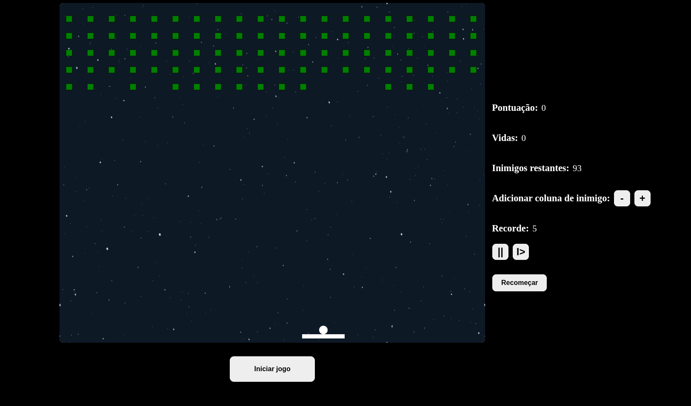
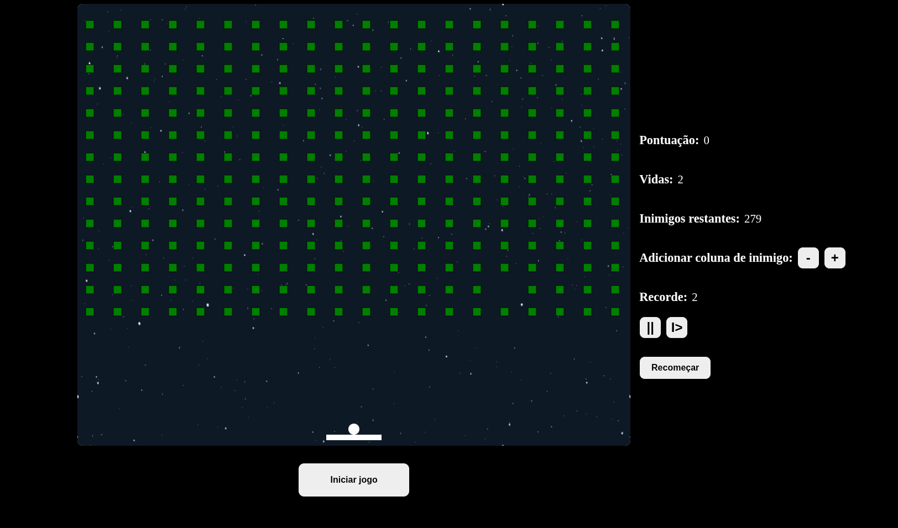
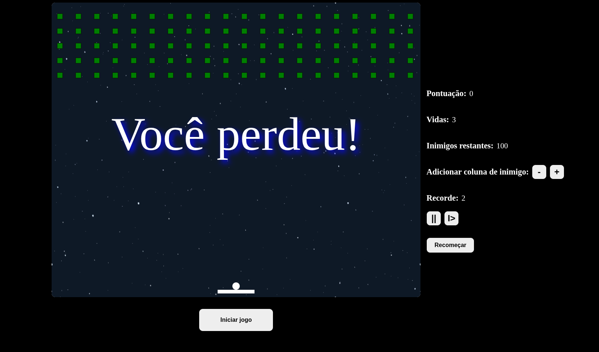

# Break Bricks Game

Jogo arcade 2D inspirado no clássico **Breakout**, desenvolvido para navegador com **TypeScript, HTML5 Canvas e CSS**, sem frameworks de interface ou game engines.

A proposta do projeto é explorar, na prática, os fundamentos do desenvolvimento de jogos: ciclo de renderização, movimentação, detecção de colisões, entrada do teclado e gerenciamento dos estados de uma partida.

## Visão geral

O jogador controla uma plataforma horizontal para rebater uma bola e destruir os blocos posicionados na parte superior do cenário. O objetivo é eliminar todos os blocos antes de perder todas as vidas.

A interface apresenta pontuação, vidas, quantidade de blocos restantes e recorde da sessão, além de controles para configurar a quantidade de blocos, pausar, retomar e reiniciar a partida.

## Capturas de tela

### Campo de jogo



*Campo de jogo, plataforma, bola, indicadores e controles da partida.*

### Quantidade de blocos ajustável



*Exemplo de partida com maior quantidade de blocos no cenário.*

### Encerramento da partida



*Mensagem de derrota apresentada no Canvas, com possibilidade de iniciar uma nova partida.*

> As imagens deste README estão em `docs/screenshots/`. Para visualizá-las no GitHub, mantenha essa pasta no repositório junto do `README.md`.

## Funcionalidades

- Renderização de elementos gráficos utilizando a **Canvas API**.
- Movimentação da bola e da plataforma, com controle pelo teclado.
- Detecção de colisões entre bola, plataforma, paredes e blocos.
- Alteração da direção da bola conforme a região de contato com a plataforma.
- Destruição dos blocos e atualização da pontuação.
- Indicadores de vidas, blocos restantes e recorde durante a sessão.
- Controles para iniciar, pausar, continuar e reiniciar a partida.
- Ajuste da quantidade de fileiras de blocos pelo painel de controle.
- Identificação das condições de vitória e derrota.

## Tecnologias

| Tecnologia | Uso no projeto |
| --- | --- |
| **TypeScript** | Implementação das classes, regras e estados do jogo. |
| **HTML5 Canvas** | Desenho e atualização dos objetos na área de jogo. |
| **HTML5** | Estrutura da página e controles da interface. |
| **CSS3** | Estilização do cenário, layout e botões. |
| **Webpack** | Compilação e empacotamento do código TypeScript para JavaScript. |

A aplicação é executada integralmente no navegador, sem backend.

## Como executar localmente

### Pré-requisitos

- Git
- Node.js e npm
- Navegador moderno com suporte a HTML5 Canvas

### 1. Clone o repositório

```bash
git clone https://github.com/cesarrafaeljunior/break-bricks-game.git
cd break-bricks-game
```

### 2. Instale as dependências

```bash
npm ci
```

### 3. Compile o projeto

```bash
npm run dev
```

Esse comando utiliza o **Webpack em modo de observação** (`--watch`). O arquivo JavaScript gerado é `public/dist/index.js`.

Mantenha esse terminal em execução enquanto estiver modificando o código. O projeto não possui, no `package.json` atual, scripts separados de `start` ou `build` para produção.

### 4. Abra o jogo no navegador

Em outro terminal, na raiz do repositório, você pode disponibilizar os arquivos com um servidor HTTP estático. Por exemplo, se tiver Python 3:

```bash
python3 -m http.server 5500
```

Acesse:

**http://localhost:5500/**

O `index.html` da raiz referencia os estilos e o JavaScript compilado. Caso altere a estrutura de pastas ou publique o jogo em outro caminho, revise também as referências de recursos estáticos existentes no projeto.

## Como jogar

1. Clique em **Iniciar jogo** para começar a partida.
2. Utilize as **setas esquerda e direita** para mover a plataforma.
3. Rebata a bola para destruir os blocos e acumular pontos.
4. Evite deixar a bola passar pela plataforma; isso reduz as vidas disponíveis.
5. Utilize os controles de **pausa**, **continuação** e **reinício** quando necessário.
6. Ajuste a quantidade de blocos pelos botões `-` e `+` do painel.

A partida termina quando todos os blocos são destruídos ou quando ocorre a condição de derrota.

## Estrutura do projeto

```text
break-bricks-game/
├── index.html                 # Página e controles do jogo
├── package.json               # Dependências e scripts
├── webpack.config.js          # Configuração de compilação
├── tsconfig.json              # Configuração TypeScript
├── public/
│   ├── assets/                # Recursos visuais
│   └── dist/                  # JavaScript compilado
├── src/
│   ├── index.ts               # Coordenação da partida e game loop
│   ├── interfaces/            # Interfaces dos objetos
│   ├── modules/
│   │   ├── ball.modules.ts    # Bola, movimento e colisões
│   │   ├── canvas.modules.ts  # Inicialização e dimensões do Canvas
│   │   ├── enemies.ts         # Blocos, disposição e colisões
│   │   ├── keyboard.modules.ts # Entrada pelo teclado
│   │   ├── pad.modules.ts     # Plataforma do jogador
│   │   └── texts.modules.ts   # Mensagens exibidas no Canvas
│   └── styles/
│       └── index.css          # Estilos da interface
└── docs/
    └── screenshots/           # Imagens usadas neste README
```

## Organização técnica

### Ciclo de jogo

A classe principal `Game`, definida em `src/index.ts`, coordena a atualização da partida. O método `gameLoop` limpa o Canvas, renderiza o fundo e atualiza os elementos do cenário, agendando o próximo quadro com `requestAnimationFrame`.

### Objetos e colisões

A lógica é dividida entre módulos com responsabilidades distintas:

- **`Ball`**: posição, velocidade, movimento e colisões com paredes e plataforma.
- **`Paddle`**: desenho, posicionamento e movimentação da plataforma.
- **`Enemies`**: criação, distribuição, remoção e contagem dos blocos.
- **`Keyboard`**: leitura das teclas utilizadas para movimentação.
- **`Texts`**: mensagens de pausa, vitória e derrota.

Os blocos são controlados por uma estrutura bidimensional, e as colisões atualizam a pontuação e a quantidade de alvos restantes.

### Estado da partida

O jogo mantém estados relacionados ao início, pausa, vitória e derrota, além dos valores de pontuação e vidas. Os comandos da interface interagem com essas informações para alterar o andamento da partida.

## Objetivos de aprendizado

O projeto foi utilizado para praticar:

- Programação orientada a objetos em TypeScript.
- Organização do código em módulos.
- Uso da API Canvas para renderização 2D.
- Atualização contínua de uma aplicação gráfica.
- Cálculo de movimento e detecção de colisões.
- Tratamento de eventos e gerenciamento de estado.

## Observações

- O recorde é controlado em memória durante a execução; não há mecanismo de persistência implementado para mantê-lo entre sessões.
- O script `npm test` presente no projeto é apenas um placeholder e não executa testes automatizados.
- O jogo foi desenvolvido como **laboratório de estudos**, e não como um produto comercial.

## Repositório

Código-fonte: **[cesarrafaeljunior/break-bricks-game](https://github.com/cesarrafaeljunior/break-bricks-game)**
